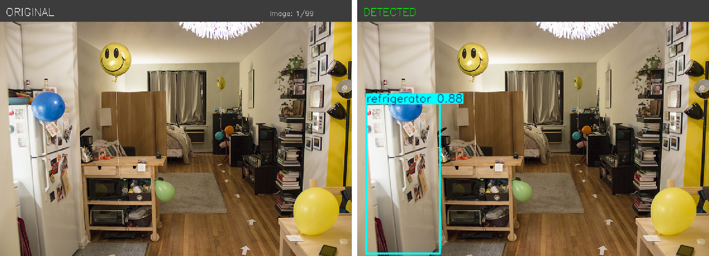
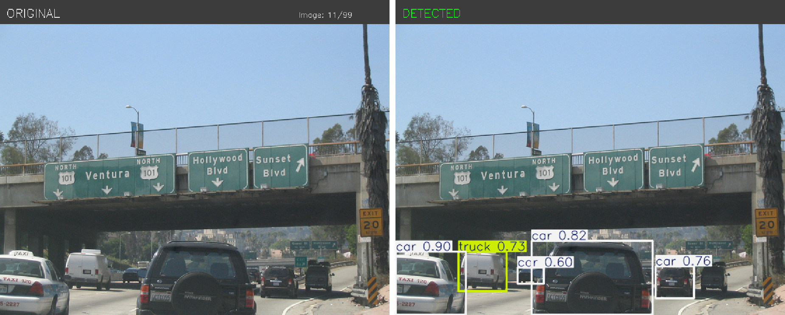
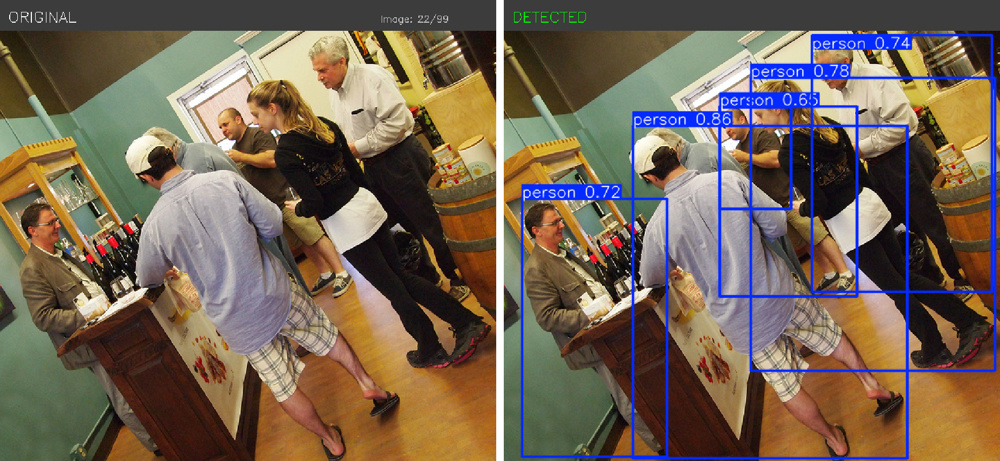
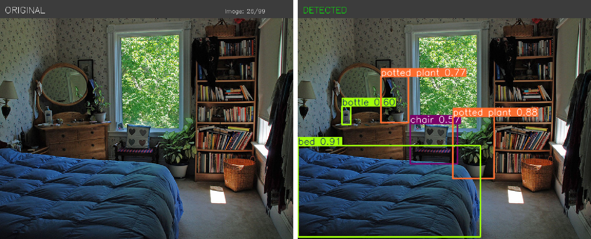

# Object Detection Using ROS 2 and YOLO

A ROS 2-based object detection project using Python and YOLO models. This repository contains the ROS 2 package, detection node, launch file, and evaluation-related scripts for object detection experiments.

**Repository:** [chidambardesai/object-detector](https://github.com/chidambardesai/object-detector)

## Features

- ROS 2 integration for object detection.
- Python-based detection node.
- Launch file for starting the detection pipeline.
- YOLO model support, depending on the configured implementation.
- Modular package structure for development and testing.
- Support for extending the project with dataset evaluation and performance analysis.

## Project Structure

```text
object-detector/
├── launch/
│   └── yolo_detector_launch.py
├── object_detector/
│   ├── __init__.py
│   └── object_detector_node.py
├── resource/
├── test/
├── package.xml
├── setup.cfg
├── setup.py
├── .gitignore
└── README.md
```

## Requirements

- Ubuntu Linux
- ROS 2 compatible with your installed distribution
- Python 3
- `colcon`
- `rosdep`
- Required Python libraries specified by the project
- Required YOLO model weights
- Dataset and annotations, if running dataset evaluation

## Installation

### 1. Clone the Repository

```bash
mkdir -p ~/ros2_ws/src
cd ~/ros2_ws/src
git clone https://github.com/chidambardesai/object-detector.git
```

### 2. Install Dependencies

```bash
cd ~/ros2_ws
source /opt/ros/$ROS_DISTRO/setup.bash
rosdep install --from-paths src --ignore-src -r -y
```

Ensure that your ROS 2 distribution is installed and `ROS_DISTRO` is set correctly.

### 3. Build the Package

```bash
cd ~/ros2_ws
colcon build --packages-select object_detector
source install/setup.bash
```

## Dataset Requirements

**Important: The dataset is not included in this GitHub repository.**

The development workspace contains a separate `datasets/` directory. Cloning this repository alone will not download that data.

Before running dataset-based evaluation:

1. Obtain the required dataset separately.
2. Place it in the directory expected by the project's scripts.
3. Ensure that the required images and ground-truth annotations are available.
4. Update dataset paths in the relevant scripts or configuration files if necessary.

The project may fail during dataset evaluation if the required data or annotations are missing.

## Model Requirements

Pretrained YOLO model weights are separate from the ROS 2 source code.

The development workspace contains files named `yolov8n.pt` and `yolov8s.pt`. These files are not included automatically when cloning this repository.

Download the model weights required by your implementation and configure the correct model path before running inference. The actual model format and supported versions depend on the detection node implementation.

## Running the Detector

After building the package and configuring its required dependencies, start the launch file:

```bash
ros2 launch object_detector yolo_detector_launch.py
```

The launch command assumes that the launch file is installed correctly and that all required model files, input topics, and parameters are configured.

If the node requires a camera, ensure that a camera driver is running and publishing images to the expected ROS 2 topic.

## Configuration

Review these files before running the project:

| File | Purpose |
|---|---|
| `object_detector/object_detector_node.py` | Object detection node |
| `launch/yolo_detector_launch.py` | Launch configuration |
| `package.xml` | ROS 2 package dependencies |
| `setup.py` | Package installation configuration |
| `setup.cfg` | Script installation settings |

## Troubleshooting

**Dataset not found:** Verify the dataset location and update the paths used by evaluation scripts.

**Model weights not found:** Download the required model and configure its path.

**ROS 2 package not found:** Source your ROS 2 installation and workspace, then rebuild if necessary.

**Missing dependencies:** Install the dependencies declared in `package.xml` and any additional Python dependencies required by the detection implementation.

## Limitations

- Runtime behavior depends on the configured ROS 2 environment.
- Dataset evaluation requires separately obtained data and annotations.
- Detection performance depends on the model, hardware, input images, and confidence threshold.
- Exact runtime parameters and topic names depend on the implementation.

## Author

**Chidambar Desai**

GitHub: [@chidambardesai](https://github.com/chidambardesai)

## License

Copyright © 2026 Chidambar Desai. All rights reserved.

This repository is publicly available for viewing. No license has been granted for copying, modifying, distributing, or using this project's code without the author's permission.

## Screenshots

### Object Detection Results








